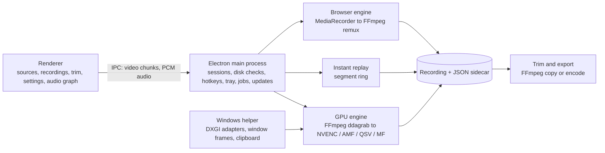

<div align="center">


# SleekRec

**Full-resolution screen recording, encoded on your GPU.**

A screen and window recorder for Windows, macOS and Linux.<br>
On Windows it captures screens, areas and windows on the GPU, up to 240 fps, and keeps an instant replay.

[](https://github.com/sevenevesai/SleekRec/releases/latest)
[](https://github.com/sevenevesai/SleekRec/actions/workflows/build.yml)

[](LICENSE)

[**Download**](https://github.com/sevenevesai/SleekRec/releases/latest) ·
[Website](https://seveneves.ai/sleekrec/) ·
[Documentation](#documentation) ·
[Report a bug](https://github.com/sevenevesai/SleekRec/issues/new)

</div>

---

Recording a game or a fast-moving desktop asks a lot of a recorder: full resolution, a high frame
rate and a file you can trust. When the recorder falls behind, the gaps usually surface only on
playback, after the moment is gone.

On Windows, SleekRec captures the screen on the graphics card that drives it and encodes it there
at source resolution: NVENC on NVIDIA, AMF on AMD, Quick Sync on Intel, with Media Foundation as
the fallback. It writes a crash-safe MKV as it records and a verified MP4 when you stop, shows the
encoded frame rate and frame gaps while you record, and saves them beside the file. Trims and
size-limited copies are separate files that never replace the original. Single windows on every
platform, and screens on macOS and Linux, record through Chromium's built-in recorder. There is
no account and nothing is uploaded.

## Features

### Record

- **GPU screen capture.** On Windows, records a whole screen as H.264 or HEVC on NVIDIA, AMD or
  Intel graphics, including laptops whose integrated GPU drives the display, at the display's
  refresh rate or a chosen rate (30 to 240 fps), with no resizing. SleekRec tests each GPU's
  encoder at startup and says which one each screen will use.
- **Areas and windows on the GPU.** Drag a rectangle or click a window to record just that area
  at full rate. A window's card can also record the window's screen area on the GPU, or the
  window alone through the browser recorder.
- **Instant replay.** Keeps the last 30 seconds to 10 minutes of a GPU source ready; a hotkey
  saves it, including the moment you pressed it.
- **Quality presets.** Low, Medium and High use ordinary 4:2:0 video. Ultra encodes 4:4:4 color
  losslessly after RGB-to-YUV conversion on NVIDIA, and its files are very large.
- **Audio.** System audio and an optional microphone, mixed or with the microphone on its own
  track for editors, plus level, mute and a raw-input switch.
- **Hotkeys and tray.** **Ctrl+Shift+F8** starts or stops the last source, **F9** stops,
  **F10** pauses, **F7** saves the replay (all with Ctrl+Shift, all configurable). A tray icon
  shows the state and can start, stop and save; SleekRec can start with Windows in the tray.
- **Recording overlay.** A small always-on-top panel shows the timer and encoded frame rate, with
  pause, microphone mute and stop buttons. It, the region border and hotkey notes stay out of the
  recording.

### Check the result

- **Live delivery.** The recording view shows encoded fps next to the requested target and, for
  GPU capture, the encoded frame gaps: 95th percentile, longest, and how many exceed 100 ms.
- **Sidecar file.** Each recording gets a `.json` file beside it with the engine, codec,
  resolution, target rate, source and preset, plus frame-gap statistics for GPU and browser
  H.264 recordings.

### Keep and share

- **MP4 when you stop.** GPU recordings capture into MKV, which survives a crash, then become an
  MP4 by stream copy, checked frame by frame before the MKV is removed. Ultra stays MKV. Browser
  recordings save as MP4 (H.264) or WebM (VP9).
- **Recordings panel.** Thumbnails, duration, size, delivered fps and frame gaps for everything
  saved. Play, trim, export, copy to the clipboard, drag into Discord or an editor, or move to the
  recycle bin. Interrupted recordings can be recovered.
- **Trim.** Set in and out points over a preview. Fast trims cut on a keyframe without
  re-encoding; exact trims start on the frame.
- **Fit under 10, 25, 50, 100 or 500 MB.** Picks a resolution and frame rate that stay legible at
  that size, encodes on the GPU and checks the result. **MP4, same video** and **Compatible
  H.264 MP4** exports are there too. Every edit is a new file next to the original.

## Install

Download from the [latest release](https://github.com/sevenevesai/SleekRec/releases/latest).

| Platform | File | First launch |
|---|---|---|
| Windows x64 | `SleekRec-<version>-win-x64.exe` (setup) or `SleekRec-<version>-win-x64.msi` | The installers are unsigned. If SmartScreen blocks one, choose **More info → Run anyway**. |
| macOS, Apple silicon | `SleekRec-<version>-mac-arm64.dmg` | If macOS blocks the app, open it once, then click **Open Anyway** in System Settings → Privacy & Security. Allow screen recording there when macOS asks. |
| macOS, Intel | `SleekRec-<version>-mac-x64.dmg` | As above. |
| Linux x64 | `SleekRec-<version>-x86_64.AppImage` or `SleekRec-<version>-linux-amd64.deb` | Make the AppImage executable (`chmod +x`); it needs FUSE 2 (`libfuse2`). Install the `.deb` with `sudo apt install ./<file>`. |

GPU capture needs Windows 10 or 11, a graphics driver with a hardware video encoder (NVIDIA,
AMD or Intel), and an unrotated display. FFmpeg is bundled on every platform.

**Updates.** The Windows setup, the AppImage, the `.deb` and Developer ID-signed macOS builds check
GitHub Releases at launch, download a newer version in the background and install it when you
quit; the `.deb` asks for an administrator password to install. MSI installs, and macOS builds that
needed **Open Anyway**, do not update themselves: download the new release instead.

## Quick start

1. Open SleekRec. Screens and windows appear as cards; a screen labelled **GPU capture** records
   on the GPU and names its encoder.
2. Click **Settings** to choose the quality, frame rate, audio, hotkeys and the output folder.
   Recordings go to `SleekRecordings` in your Videos folder (Movies on macOS) by default. For
   gameplay, choose **High** or **Ultra** and **Match display refresh**, and keep Windows HDR off.
3. Click a card to start recording, or **Record an area…** to pick part of the screen. For a game,
   pick the screen it runs on and play in borderless fullscreen, which avoids display-mode
   switches. After that, **Ctrl+Shift+F8** starts and stops the same source from inside the game.
4. Stop with the overlay's stop button or a hotkey. The **Recordings** tab opens with the new file.
5. To share it, use **Export ▾ → Fit under 10 MB**, or drag the card into a chat.
6. For instant replay, click **Instant replay** on a screen card and press **Ctrl+Shift+F7**
   whenever something worth keeping happens.

> [!IMPORTANT]
> GPU capture records everything visible in the screen or area, including any other window or
> notification that appears on it. To record one window only, whatever covers it, pick it under
> **Windows**; that uses the slower browser recorder.

## How it works



- **Renderer** [React, TypeScript, Tailwind]: the source picker, recordings panel, trim editor,
  settings, Chromium's MediaRecorder for browser capture, and a Web Audio graph that turns system
  audio and the microphone into one to three PCM tracks through an AudioWorklet. The overlay,
  toast and area picker are separate static pages.
- **Main process** [Electron, TypeScript]: settings, one recording session at a time, instant
  replay, free-space checks, global hotkeys, the tray, one export or trim job at a time, a range-
  serving media protocol for previews, and the GitHub Releases updater (electron-updater).
- **GPU engine** [FFmpeg 6.1.1, three small patches]: `ddagrab` desktop duplication on the
  adapter that owns the display, encoded on that adapter, with the renderer's PCM muxed in live;
  MKV parts on disk, an MP4 on a clean stop.
- **Browser engine** [FFmpeg]: streams MediaRecorder chunks to disk in order, then remuxes H.264
  into MP4 or keeps VP9 as WebM.
- **Windows helper** [C++, DXGI]: matches Electron's displays to DXGI adapters and outputs,
  reports window frames for area capture, copies files to the clipboard, and runs FFmpeg in a
  kill-on-close job so capture cannot outlive the app.

Windows ships a trimmed FFmpeg 6.1.1 build from `vendor/ffmpeg`; macOS and Linux use
[ffmpeg-static](https://github.com/eugeneware/ffmpeg-static). Engine contracts, stop ordering and
the FFmpeg 6.1 workarounds are in [docs/recording.md](docs/recording.md).

## Safety guarantees

- Trims and exports never overwrite an existing file and never modify or delete the recording
  they read. Delete moves files to the recycle bin.
- Capture parts are deleted only after the MP4 or MKV built from them verifies. A failed save, a
  forced stop or a renderer crash keeps the partial files, and the recordings panel can recover
  them.
- Recording does not start with less than 512 MB free in the output folder, and stops when free
  space falls below that.
- On Windows, GPU capture stops when SleekRec crashes or is killed, instead of leaving FFmpeg
  writing to the disk.
- The only network request the app makes is the update check against GitHub Releases.

## Known limitations

- GPU capture works only on Windows, on unrotated displays. HDR displays record an SDR conversion
  and 10-bit capture is not supported. AMD and Intel encoding has been checked against FFmpeg but
  not yet run on AMD or Intel hardware; if a GPU's encoder fails its startup test, SleekRec uses
  Media Foundation or says GPU capture is unavailable. If Automatic mode cannot map a Windows
  screen to GPU capture it reports an error; choose **Browser** in Settings to record that screen
  the slower way.
- An area or window area is fixed when recording starts: it does not follow a moving window.
- Instant replay, areas and separate microphone tracks need GPU capture. Starting a recording
  pauses instant replay until the recording is saved.
- GPU capture is desktop duplication, not a game hook. Exclusive-fullscreen transitions, display
  changes, protected content and driver resets can interrupt it.
- The frame rate you choose is a target. Delivery depends on game and GPU load and disk speed: a
  165 Hz display does not guarantee 165 recorded frames per second. On a static desktop the
  encoder repeats the last image, so encoded fps does not count unique frames.
- Ultra is lossless after RGB-to-YUV conversion, not bit-identical screen RGB. It needs a player
  or editor that accepts 4:4:4 video and can exceed several GB per minute, and needs NVIDIA. Use
  **Compatible H.264 MP4** or **Fit under** for a widely playable copy.
- Window capture, and all capture on macOS and Linux, uses the browser recorder: lossy and often
  at a lower frame rate. Capture and system audio on macOS and Linux have not been verified on
  those platforms yet.
- MKV masters improve recovery after a crash or a full disk, but the last frames can still be lost.

## Documentation

| Guide | Covers |
|---|---|
| [Recording engines](docs/recording.md) | Engine selection, GPU adapters and encoders, areas, audio tracks, stop ordering, MP4 finalize, pause and recovery, tests and remaining validation |
| [Instant replay](docs/instant-replay.md) | The segment ring, saving, disk bounds and its interplay with recording |
| [Recordings, trim and export](docs/library-and-editing.md) | The recordings panel, thumbnails, recovery, trim, fit-to-size and export |
| [Hotkeys, tray and startup](docs/hotkeys-and-tray.md) | Global hotkeys, the remembered source, toasts, the tray and launch options |
| [Trimmed Windows FFmpeg](scripts/ffmpeg/README.md) | The vendored FFmpeg build: pins, toolchain, configure line and how to add a component |
| [Electron upgrade audit](docs/electron-upgrade.md) | Electron 29 to 44 breaking changes checked against SleekRec, and the loopback-audio probe |
| [Stutter investigation](docs/recording-investigation.md) | Measured frame gaps in a reported browser recording, and the limits of the validation |
| [Size, speed and safety plan](docs/plan-size-speed-safety.md) | The completed slimming work and its measured size and idle-CPU results |
| [Roadmap](docs/roadmap.md) | The ranked next improvements, with the evidence and mechanism for each |

## Build from source

Prerequisites: Node.js 22.12 or newer (required by Electron). On Windows, Visual Studio C++ Build
Tools with the Windows SDK, which compile the display helper; installed copies of SleekRec do not
need them.

```sh
npm install
npm run dev            # builds the Windows helper, then starts Electron with Vite
npm run build:win      # NSIS setup, MSI and win-unpacked in dist_app/, with the helper and FFmpeg
npm run build:mac      # DMG and ZIP for arm64 and x64
npm run build:linux    # AppImage and .deb
npm run icons          # regenerate platform icons from build/icon.svg
```

Checks:

```sh
npx tsc --noEmit         # type check; prints nothing on success
npm test                 # recording and export tests; all must pass
npm run test:recording   # Windows GPU hardware smoke test; prints SMOKE PASS
```

CI runs the type check and `npm test` on Windows, macOS and Linux before building each package;
tests that need a GPU encoder skip where there is none. The smoke test records the first GPU
screen with system audio for 60 seconds (set `SLEEK_SMOKE_SECONDS` to shorten it), then pause
and resume, separate audio tracks, a hotkey-started area, an instant replay and browser capture,
and checks the recordings list, a trim and a fit-to-size export, using an isolated profile under
`.test-output`. Read [docs/recording.md](docs/recording.md) before changing recording or export.

### Releasing

Push a tag `v<version>` matching `package.json`. CI builds every platform and publishes a GitHub
Release with the `latest*.yml` and `.blockmap` files the in-app updater reads.

CI signs the macOS app with a Developer ID and notarizes it when the repository has all five
Actions secrets below. With none of them it builds an unsigned app, and with only some the macOS
job fails. Pull request builds stay unsigned.

| Secret | Value |
|---|---|
| `MACOS_CERTIFICATE_P12` | Base64 of the exported Developer ID Application certificate and key (`base64 -i cert.p12`) |
| `MACOS_CERTIFICATE_PASSWORD` | Password set when exporting that `.p12` |
| `APPLE_API_KEY_P8` | Contents of the App Store Connect API key file (`AuthKey_<id>.p8`) |
| `APPLE_API_KEY_ID` | That key's ID |
| `APPLE_API_ISSUER` | The issuer ID shown above the App Store Connect key list |

The macOS updater runs only when the installed app passes `codesign --verify` against the
Developer ID requirement, because Squirrel.Mac refuses updates for anything else.

## Project structure

```
electron/       Main process: sessions, GPU and browser engines, replay, library, export, hotkeys, tray
src/            Renderer: React UI, recordings panel, trim editor, audio graph and worklet, page scripts
native/         Windows helper (C++), built by scripts/build-native.cjs
scripts/        Tests, hardware smoke test, icon and helper builds, FFmpeg build recipe and patches
vendor/ffmpeg/  Trimmed FFmpeg 6.1.1 for Windows, with its license notices
build/          App icons and macOS entitlements
docs/           Design notes, audits and investigations
website/        Product page files
index.html      Main window page
overlay.html    Recording overlay page
toast.html      Hotkey feedback over games
region.html     Area picker
frame.html      Border around a recorded area
```

## Contributing

Report bugs and request features in [Issues](https://github.com/sevenevesai/SleekRec/issues).
For a recording problem, attach the `.json` file saved beside the recording: it names the engine,
codec, source and frame-gap statistics.

## License

SleekRec is released under the [MIT License](LICENSE). The bundled FFmpeg keeps its own license:
the Windows build includes libx264 and is distributed under the GPL version 2 or later, with notices
for it and the statically linked libraries in [vendor/ffmpeg/win32-x64/LICENSE.txt](vendor/ffmpeg/win32-x64/LICENSE.txt). macOS and Linux
builds use the FFmpeg binaries from ffmpeg-static, under their respective licenses.
