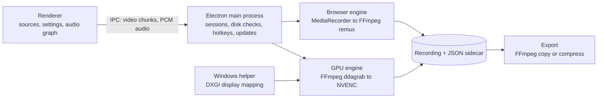

<div align="center">


# SleekRec

**Full-resolution screen recording, encoded on your GPU.**

A screen and window recorder for Windows, macOS and Linux.<br>
On Windows with an NVIDIA GPU, it captures whole screens and encodes them on the GPU, up to 240 fps.

[](https://github.com/sevenevesai/SleekRec/releases/latest)
[](https://github.com/sevenevesai/SleekRec/actions/workflows/build.yml)

[](LICENSE)

[**Download**](https://github.com/sevenevesai/SleekRec/releases/latest) ·
[Website](https://seveneves.ai/sleekrec/) ·
[Documentation](#documentation) ·
[Report a bug](https://github.com/sevenevesai/SleekRec/issues/new)

</div>

---

Recording a game or a fast-moving desktop asks a lot of a recorder: full resolution, a high frame
rate and a file you can trust. When the recorder falls behind, the gaps usually surface only on
playback, after the moment is gone.

On Windows with an NVIDIA GPU, SleekRec captures the screen and encodes it with NVENC at source
resolution, writing an MKV master as it records. It shows the encoded frame rate and frame gaps
while you record and saves them beside the file. Compression is a separate export that never
replaces the master. Single windows on every platform, and screens on macOS and Linux, record
through Chromium's built-in recorder. There is no account and nothing is uploaded.

## Features

### Record

- **GPU screen capture.** On Windows with an NVIDIA GPU, records a whole screen as H.264 or HEVC
  at the display's refresh rate or a chosen rate (30 to 240 fps), with no resizing.
- **Screens and windows.** Sources are listed separately, GPU screens first. A window records
  only that window; its card also offers to record the window's whole screen on the GPU instead.
- **Quality presets.** Low, Medium and High use ordinary 4:2:0 video. Ultra encodes 4:4:4 color
  losslessly after RGB-to-YUV conversion, and its files are very large.
- **Audio.** System audio, an optional microphone with level and mute, and a raw-input switch
  that turns off echo cancellation, noise suppression and automatic gain together.
- **Pause and hotkeys.** Pause and resume as often as needed. **Ctrl+Shift+F9** stops and saves;
  **Ctrl+Shift+F10** pauses and resumes (Cmd instead of Ctrl on macOS).
- **Recording overlay.** A small always-on-top panel shows the timer and encoded frame rate, with
  pause, microphone mute and stop buttons. The main window minimizes while you record.

### Check the result

- **Live delivery.** The recording view shows encoded fps next to the requested target and, for
  GPU capture, the encoded frame gaps: 95th percentile, longest, and how many exceed 100 ms.
- **Sidecar file.** Each recording gets a `.json` file beside it with the engine, codec,
  resolution, target rate, source and preset, plus frame-gap statistics for GPU and browser
  H.264 recordings.

### Keep and share

- **Masters.** GPU recordings save as MKV. An uninterrupted recording is finalized without
  re-encoding, and paused segments are joined by stream copy. Browser recordings save as MP4
  (H.264) or WebM (VP9).
- **Export.** **MP4 · same video quality** copies H.264 or HEVC video into MP4. **Smaller MP4**
  re-encodes to H.264, with NVENC on Windows when it is available and on the CPU otherwise.
  Exports go next to the source as `<name>_export.mp4` or `<name>_smaller.mp4`.

## Install

Download from the [latest release](https://github.com/sevenevesai/SleekRec/releases/latest).

| Platform | File | First launch |
|---|---|---|
| Windows x64 | `SleekRec-<version>-win-x64.exe` (setup) or `SleekRec-<version>-win-x64.msi` | The installers are unsigned. If SmartScreen blocks one, choose **More info → Run anyway**. |
| macOS, Apple silicon | `SleekRec-<version>-mac-arm64.dmg` | If macOS blocks the app, open it once, then click **Open Anyway** in System Settings → Privacy & Security. Allow screen recording there when macOS asks. |
| macOS, Intel | `SleekRec-<version>-mac-x64.dmg` | As above. |
| Linux x64 | `SleekRec-<version>-x86_64.AppImage` or `SleekRec-<version>-linux-amd64.deb` | Make the AppImage executable (`chmod +x`); it needs FUSE 2 (`libfuse2`). Install the `.deb` with `sudo apt install ./<file>`. |

GPU capture needs Windows, an NVIDIA GPU as the default graphics adapter, and an unrotated SDR
display. FFmpeg is bundled on every platform.

**Updates.** The Windows setup, the AppImage, the `.deb` and Developer ID-signed macOS builds check
GitHub Releases at launch, download a newer version in the background and install it when you
quit; the `.deb` asks for an administrator password to install. MSI installs, and macOS builds that
needed **Open Anyway**, do not update themselves: download the new release instead.

## Quick start

1. Open SleekRec. Screens and windows appear as cards; a screen labelled **GPU capture** records
   on the GPU.
2. Click **Settings** to choose **Recording Quality**, the frame rate, audio and the **Output
   Folder**. Recordings go to `SleekRecordings` in your Videos folder (Movies on macOS) by default.
   For gameplay, choose **Ultra** and **Match display refresh**, and keep Windows HDR off.
3. Click a card to start recording. For a game, pick the screen it runs on and play in borderless
   fullscreen, which avoids display-mode switches.
4. Stop with the overlay's stop button or **Ctrl+Shift+F9**. SleekRec shows the saved file in your
   file manager.
5. To share a smaller copy, click **Smaller MP4** under **Export an existing recording** and pick
   the recording.

> [!IMPORTANT]
> GPU capture records the entire screen, including any other window or notification that
> appears on it. To record one window only, pick it under **Windows**; that uses the slower
> browser recorder.

## How it works



- **Renderer** [React, TypeScript, Tailwind]: the source picker, settings, Chromium's
  MediaRecorder for browser capture, and a Web Audio graph that mixes system audio and the
  microphone into PCM through an AudioWorklet. The overlay is a separate static page.
- **Main process** [Electron, TypeScript]: settings, one recording session at a time, free-space
  checks, global hotkeys, the overlay window and the GitHub Releases updater (electron-updater).
- **GPU engine** [FFmpeg 6.1.1]: `ddagrab` desktop duplication into NVENC, with the renderer's
  PCM muxed in live; output is a Matroska master written straight to disk.
- **Browser engine** [FFmpeg]: streams MediaRecorder chunks to disk in order, then remuxes H.264
  into MP4 or keeps VP9 as WebM.
- **Windows helper** [C++, DXGI]: matches Electron's displays to DXGI outputs on the default
  adapter, and runs FFmpeg in a kill-on-close job so capture cannot outlive the app.

Windows ships a trimmed FFmpeg 6.1.1 build from `vendor/ffmpeg`; macOS and Linux use
[ffmpeg-static](https://github.com/eugeneware/ffmpeg-static). Engine contracts, stop ordering and
the FFmpeg 6.1 workarounds are in [docs/recording.md](docs/recording.md).

## Safety guarantees

- Export never overwrites an existing file and never modifies or deletes the master it reads.
- Paused segments are deleted only after the stream-copy join succeeds. A failed save, a forced
  stop or a renderer crash keeps the partial files.
- Recording does not start with less than 512 MB free in the output folder, and stops when free
  space falls below that.
- On Windows, GPU capture stops when SleekRec crashes or is killed, instead of leaving FFmpeg
  writing to the disk.
- The only network request the app makes is the update check against GitHub Releases.

## Known limitations

- GPU capture works only on Windows, with the default NVIDIA adapter, on unrotated SDR displays.
  Other GPUs, HDR and 10-bit capture are not supported. If Automatic mode cannot map a Windows
  screen to GPU capture it reports an error; choose **Browser** in Settings to record that screen
  the slower way.
- GPU capture is desktop duplication, not a game hook. Exclusive-fullscreen transitions, display
  changes, protected content and driver resets can interrupt it.
- The frame rate you choose is a target. Delivery depends on game and GPU load and disk speed: a
  165 Hz display does not guarantee 165 recorded frames per second. On a static desktop the
  encoder repeats the last image, so encoded fps does not count unique frames.
- Ultra is lossless after RGB-to-YUV conversion, not bit-identical screen RGB. It needs a player
  or editor that accepts 4:4:4 video and can exceed several GB per minute. Use **Smaller MP4** for
  a widely playable copy.
- Window capture, and all capture on macOS and Linux, uses the browser recorder: lossy and often
  at a lower frame rate. Capture and system audio on macOS and Linux have not been verified on
  those platforms yet.
- MKV masters improve recovery after a crash or a full disk, but the last frames can still be lost.

## Documentation

| Guide | Covers |
|---|---|
| [Recording engines](docs/recording.md) | Engine selection, GPU and browser capture, audio, stop ordering, pause and recovery, export, tests and remaining validation |
| [Trimmed Windows FFmpeg](scripts/ffmpeg/README.md) | The vendored FFmpeg build: pins, toolchain, configure line and how to add a component |
| [Electron upgrade audit](docs/electron-upgrade.md) | Electron 29 to 44 breaking changes checked against SleekRec, and the loopback-audio probe |
| [Stutter investigation](docs/recording-investigation.md) | Measured frame gaps in a reported browser recording, and the limits of the validation |
| [Size, speed and safety plan](docs/plan-size-speed-safety.md) | The completed slimming work and its measured size and idle-CPU results |

## Build from source

Prerequisites: Node.js 22.12 or newer (required by Electron). On Windows, Visual Studio C++ Build
Tools with the Windows SDK, which compile the display helper; installed copies of SleekRec do not
need them.

```sh
npm install
npm run dev            # builds the Windows helper, then starts Electron with Vite
npm run build:win      # NSIS setup, MSI and win-unpacked in dist_app/, with the helper and FFmpeg
npm run build:mac      # DMG and ZIP for arm64 and x64
npm run build:linux    # AppImage and .deb
npm run icons          # regenerate platform icons from build/icon.svg
```

Checks:

```sh
npx tsc --noEmit         # type check; prints nothing on success
npm test                 # recording and export tests; all must pass
npm run test:recording   # Windows + NVIDIA hardware smoke test; prints SMOKE PASS
```

CI runs the type check and `npm test` on Windows, macOS and Linux before building each package.
The smoke test records the first supported screen with system audio for 60 seconds (set
`SLEEK_SMOKE_SECONDS` to shorten it), then tests pause, resume and browser capture, using an
isolated profile under `.test-output`. Read [docs/recording.md](docs/recording.md) before changing
recording or export.

### Releasing

Push a tag `v<version>` matching `package.json`. CI builds every platform and publishes a GitHub
Release with the `latest*.yml` and `.blockmap` files the in-app updater reads.

CI signs the macOS app with a Developer ID and notarizes it when the repository has all five
Actions secrets below. With none of them it builds an unsigned app, and with only some the macOS
job fails. Pull request builds stay unsigned.

| Secret | Value |
|---|---|
| `MACOS_CERTIFICATE_P12` | Base64 of the exported Developer ID Application certificate and key (`base64 -i cert.p12`) |
| `MACOS_CERTIFICATE_PASSWORD` | Password set when exporting that `.p12` |
| `APPLE_API_KEY_P8` | Contents of the App Store Connect API key file (`AuthKey_<id>.p8`) |
| `APPLE_API_KEY_ID` | That key's ID |
| `APPLE_API_ISSUER` | The issuer ID shown above the App Store Connect key list |

The macOS updater runs only when the installed app passes `codesign --verify` against the
Developer ID requirement, because Squirrel.Mac refuses updates for anything else.

## Project structure

```
electron/       Main process: sessions, GPU and browser engines, export, updater, preload
src/            Renderer: React UI, audio capture graph and worklet, overlay script
native/         Windows display helper (C++), built by scripts/build-native.cjs
scripts/        Tests, hardware smoke test, icon and helper builds, FFmpeg build recipe
vendor/ffmpeg/  Trimmed FFmpeg 6.1.1 for Windows, with its license notices
build/          App icons and macOS entitlements
docs/           Design notes, audits and investigations
website/        Product page files
index.html      Main window page
overlay.html    Recording overlay page
```

## Contributing

Report bugs and request features in [Issues](https://github.com/sevenevesai/SleekRec/issues).
For a recording problem, attach the `.json` file saved beside the recording: it names the engine,
codec, source and frame-gap statistics.

## License

SleekRec is released under the [MIT License](LICENSE). The bundled FFmpeg keeps its own license:
the Windows build includes libx264 and is distributed under the GPL version 2 or later, with notices
in [vendor/ffmpeg/win32-x64/LICENSE.txt](vendor/ffmpeg/win32-x64/LICENSE.txt). macOS and Linux
builds use the FFmpeg binaries from ffmpeg-static, under their respective licenses.
